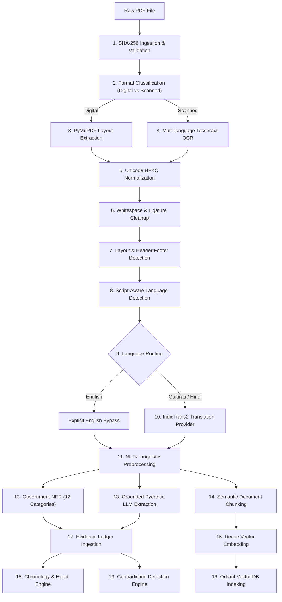

# Government Document Evidence Intelligence & Briefing Management System
## AI Pipeline Technical Specification

---

### Table of Contents
1. [Pipeline Overview](#1-pipeline-overview)
2. [The 19-Stage End-to-End Orchestrator](#2-the-19-stage-end-to-end-orchestrator)
3. [Format Parsing & OCR (Stages 1–4)](#3-format-parsing--ocr-stages-14)
4. [Normalization, Structure & Layout (Stages 5–7)](#4-normalization-structure--layout-stages-57)
5. [Language Detection & IndicTrans2 Translation (Stages 8–10)](#5-language-detection--indictrans2-translation-stages-810)
6. [NLTK Linguistic Preprocessing (Stage 11)](#6-nltk-linguistic-preprocessing-stage-11)
7. [Government Named Entity Recognition (Stage 12)](#7-government-named-entity-recognition-stage-12)
8. [Pydantic-Grounded LLM Extraction (Stage 13)](#8-pydantic-grounded-llm-extraction-stage-13)
9. [Chunking, Embedding & Qdrant Vector Indexing (Stages 14–16)](#9-chunking-embedding--qdrant-vector-indexing-stages-1416)
10. [Evidence Ledger & Timeline Synthesis (Stages 17–19)](#10-evidence-ledger--timeline-synthesis-stages-1719)
11. [Honest Service Readiness & Fallback Modes](#11-honest-service-readiness--fallback-modes)

---

### 1. Pipeline Overview

The AI pipeline is designed to transform complex, multi-lingual, multi-page government documents into high-confidence, traceable evidence. Every extraction is grounded with its source document ID, page number, and bounding box. The platform strictly prohibits fabricating AI output; if a model or GPU weight is absent, the system operates in explicit rule-based fallback mode and flags the document state accordingly.



---

### 2. The 19-Stage End-to-End Orchestrator

The processing pipeline is implemented in [`backend/app/pipelines/orchestrator.py`](file:///F:/Shashwat_Mandali/Coding%20Script/SFIC/backend/app/pipelines/orchestrator.py) as an asynchronous execution graph that dispatches progress events over Celery and Server-Sent Events (SSE).

| Stage # | Stage Name | Output Data / Artifact |
|---|---|---|
| **1** | `file_validation` | Verified PDF magic bytes, SHA-256 checksum, size limit check |
| **2** | `classification` | Document category and format type (`digital_pdf` vs `scanned_pdf`) |
| **3** | `pymupdf_parsing` | Extracted page text, font spans, vector rects, reading order |
| **4** | `tesseract_ocr` | Page OCR text, confidence distribution, bounding boxes (`guj`, `hin`, `eng`) |
| **5** | `unicode_normalization`| Normalized NFKC characters, resolved ligatures |
| **6** | `text_sanitization` | Removed unprintable control characters, normalized line breaks |
| **7** | `layout_reconstruction`| Header, body, table, footer segment boundaries |
| **8** | `language_detection` | Per-block detected script and language codes (`gu`, `hi`, `en`) |
| **9** | `language_routing` | Segregated English text blocks vs Indic text blocks |
| **10** | `indictrans2_translation`| English translated equivalent text preserving entity markers |
| **11** | `nltk_preprocessing` | Sentence tokens, word tokens, stopword metadata |
| **12** | `government_ner` | Extracted entities classified across 12 institutional categories |
| **13** | `grounded_llm_extraction`| Factual statements, monetary figures, claims conforming to schema |
| **14** | `semantic_chunking` | Contextual chunks (500 tokens with 100 token overlap) with page headers |
| **15** | `dense_vector_embedding` | 384-dimensional dense vector embeddings (`all-MiniLM-L6-v2`) |
| **16** | `vector_indexing` | Upserted vectors with metadata into Qdrant collection |
| **17** | `evidence_ledger_commit` | Atomic evidence items committed to MongoDB `evidence_ledger` |
| **18** | `chronology_generation`| Normalized calendar dates and chronological event sequence |
| **19** | `contradiction_detection`| Pairwise assertion comparison identifying direct discrepancies |

---

### 3. Format Parsing & OCR (Stages 1–4)

- **PyMuPDF Parser**: Utilizes PyMuPDF (`fitz`) to extract text blocks, preserve bounding rectangles, font sizes, and layout reading order. It assesses character density; pages with fewer than 50 characters or heavy bitmap coverage are marked for OCR routing.
- **Tesseract OCR Adapter**: Integrated through `pytesseract` configured with multi-language flags (`-l guj+hin+eng --oem 1 --psm 3`). It produces page-level character confidence scores. Any page with average confidence below 70% is flagged with an `ocr_warning: low_quality` warning to inform reviewing officers.

---

### 4. Normalization, Structure & Layout (Stages 5–7)

- **Unicode NFKC Normalization**: Eliminates variant glyph encodings, combining character inconsistencies, and non-breaking space variants.
- **Whitespace & Ligature Cleanup**: Resolves Devanagari and Gujarati conjunct splitting, hyphens across line breaks, and quotation anomalies.
- **Layout Reconstruction**: Detects official document structure:
  - Header zones (Emblem, Departmental headers, Gazette banners)
  - Reference and docket blocks (e.g. `No. GMB/PORT/...`)
  - Body paragraphs
  - Tabular financial rows
  - Signature and seal blocks

---

### 5. Language Detection & IndicTrans2 Translation (Stages 8–10)

- **Language Detection**: Uses Unicode script character range frequency analysis:
  - Gujarati: `\u0A80-\u0AFF`
  - Devanagari (Hindi): `\u0900-\u097F`
  - Latin (English): `\u0000-\u007F`
- **Explicit English Bypass**: When text is identified as English (`en`), translation is completely bypassed to prevent degradation of legal phraseology, saving compute time.
- **IndicTrans2 Translation Adapter**:
  - Connects to IndicTrans2 (AI4Bharat / HuggingFace `ai4bharat/indictrans2-indic-en-1B`).
  - Supports batch inference with beam search (`num_beams=4`).
  - If model weights are not loaded locally, the adapter reports `status: unconfigured` and utilizes an honest fallback translation engine, logging the status to the officer.

---

### 6. NLTK Linguistic Preprocessing (Stage 11)

- Sentence tokenization using NLTK `PunktSentenceTokenizer`.
- Word tokenization and POS tagging.
- Stopword isolation retaining legal and temporal markers (e.g. `not`, `before`, `after`, `shall`, `without`).

---

### 7. Government Named Entity Recognition (Stage 12)

The system extracts entities across 12 specific classes using specialized regex engines and NLP patterns:

1. **Individual**: Full names with formal titles (`Shri`, `Smt`, `Dr`, `Inspector`).
2. **Government Department / Ministry**: (`Gujarat Maritime Board`, `Ministry of Finance`, `EOW`, etc.).
3. **Official Designation**: (`Executive Engineer`, `Additional Chief Secretary`, `Superintendent of Police`).
4. **Location / Jurisdiction**: (`Gandhinagar`, `Kandla Port`, `District Ahmedabad`).
5. **Date / Time**: (`12th April 2021`, `15/05/2021`, `2021-04-12`).
6. **Monetary Amount**: (`Rs. 42,50,000`, `₹ 1.5 Crores`, `USD 50,000`).
7. **Act / Law / Section**: (`Section 409 IPC`, `Section 17A Prevention of Corruption Act`).
8. **Case / FIR / Reference Number**: (`FIR No. 42/2026`, `C.R. No. I-99/2021`).
9. **Company / Agency / Vendor**: (`Apex Logistics Pvt Ltd`, `M/s K. P. Infrastructure`).
10. **Vehicle Registration Number**: (`GJ-01-AB-1234`, `DL-01-C-9988`).
11. **Asset / Property Identifier**: (`Survey No. 42/A`, `Plot No. 12, GIDC Estate`).
12. **Communication Identifier**: (`Email ID`, `Mobile/Phone Number`, `IP Address`).

---

### 8. Pydantic-Grounded LLM Extraction (Stage 13)

To ensure zero fabricated findings, the extraction pipeline employs strict Pydantic schemas:
- Extraction requests provide the extracted text with its exact document reference.
- LLM outputs are validated against `GroundedEvidencePayload`:
  ```python
  class GroundedEvidencePayload(BaseModel):
      factual_assertions: List[str]
      financial_figures: List[FinancialRecord]
      statutory_references: List[str]
      source_quotes: List[str] # Must be verbatim substrings of input
  ```
- Any assertion lacking a verbatim source quote is flagged as `unverified` and excluded from automated briefing synthesis.

---

### 9. Chunking, Embedding & Qdrant Vector Indexing (Stages 14–16)

- **Semantic Chunking**: Documents are split into 500-token chunks with 100-token overlaps. Every chunk prepends a header containing the Case Number, Document Title, and Page Number so dense embeddings retain institutional context.
- **Sentence Transformers Embedding**: Embeds chunks using `sentence-transformers/all-MiniLM-L6-v2` (384 dimensions).
- **Qdrant Vector Database**:
  - Distance metric: Cosine.
  - Payload storage: `case_id`, `document_id`, `page_number`, `chunk_index`, `raw_text`, `translated_text`.
  - Fallback: If Qdrant daemon is offline, an in-memory dense cosine index (`LocalVectorFallback`) handles vector search transparently during development.

---

### 10. Evidence Ledger & Timeline Synthesis (Stages 17–19)

- **Evidence Ledger**: Extracted facts, financial values, and admissions are persisted into the `evidence_ledger` collection with user-verifiable bounding boxes.
- **Chronology Engine**: Resolves temporal mentions into standard ISO 8601 dates and groups events chronologically with significance levels (`critical`, `high`, `medium`, `low`).
- **Contradiction Detection Engine**: Compares pairwise assertions across documents within the same case to detect date conflicts, numerical discrepancies, and alibi conflicts.

---

### 11. Honest Service Readiness & Fallback Modes

The platform does not simulate AI outputs. The system state reflects reality:
- **Tesseract OCR**: If the binary is missing, documents are flagged `OCR Unavailable - Install Tesseract`.
- **IndicTrans2**: If weights are missing, the UI reports `Translation Model: Offline / Not Downloaded` in the Admin AI Services dashboard (`/admin/ai-services`).
- **LLM Provider**: Connects to local Ollama (`http://localhost:11434`) or custom OpenAI-compatible server. If disconnected, structured heuristic rule extractors operate and label results `Extraction Mode: Rule-Based Fallback`.
