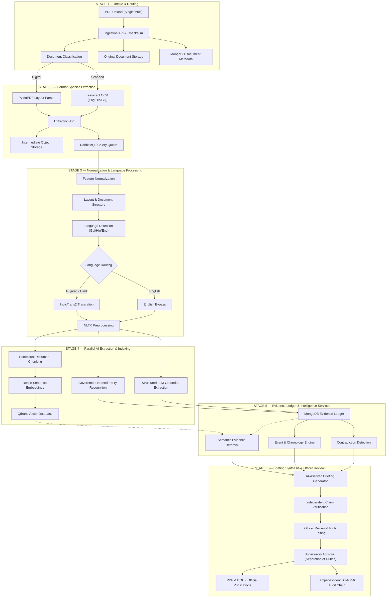

# Government Document Evidence Intelligence & Briefing Management System
## Authoritative System Architecture Specification

### 1. Architectural Overview
The platform is organized into six authoritative sequential architectural stages, transforming unstructured and semi-structured multilingual documents into traceable, verifiable evidence records and briefings.

### 2. The Six Architectural Stages
1. **Document Intake and Routing**: File validation, SHA-256 calculation, duplicate detection, immutable original file persistence, and metadata initialization.
2. **Format-Specific Extraction and Job Dispatch**: Digital parsing via PyMuPDF; scanned document processing via Tesseract with Hindi and Gujarati packs; asynchronous Celery job dispatch.
3. **Document Normalization, Structure and Language Processing**: Unicode NFKC normalization, layout reconstruction, segment-level language detection, IndicTrans2 translation for Gujarati/Hindi, explicit English bypass, and NLTK preprocessing.
4. **AI-Powered Evidence Extraction and Indexing**: NER across 12 government-specific entity classes, structured LLM extraction conforming to Pydantic schemas, chunking, and Qdrant vector indexing.
5. **MongoDB Evidence Ledger & Intelligence Services**: Centralized structured evidence register, timeline chronological engine, pairwise contradiction detection, and hybrid vector/metadata evidence retrieval.
6. **Briefing Generation, Claim Verification & Officer Review**: 16-section briefing synthesis, atomic claim verification, 3-column officer editing workspace, supervisory sign-off enforcing separation of duties, and tamper-evident SHA-256 audit chaining.
